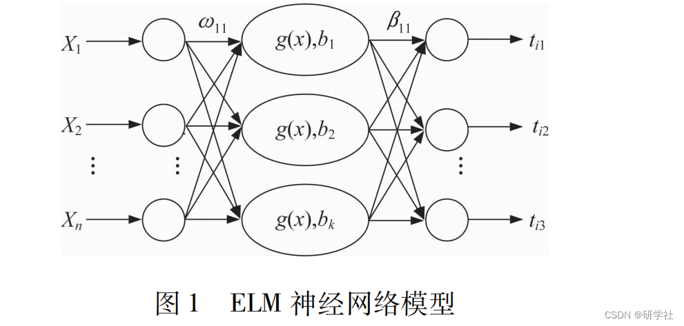
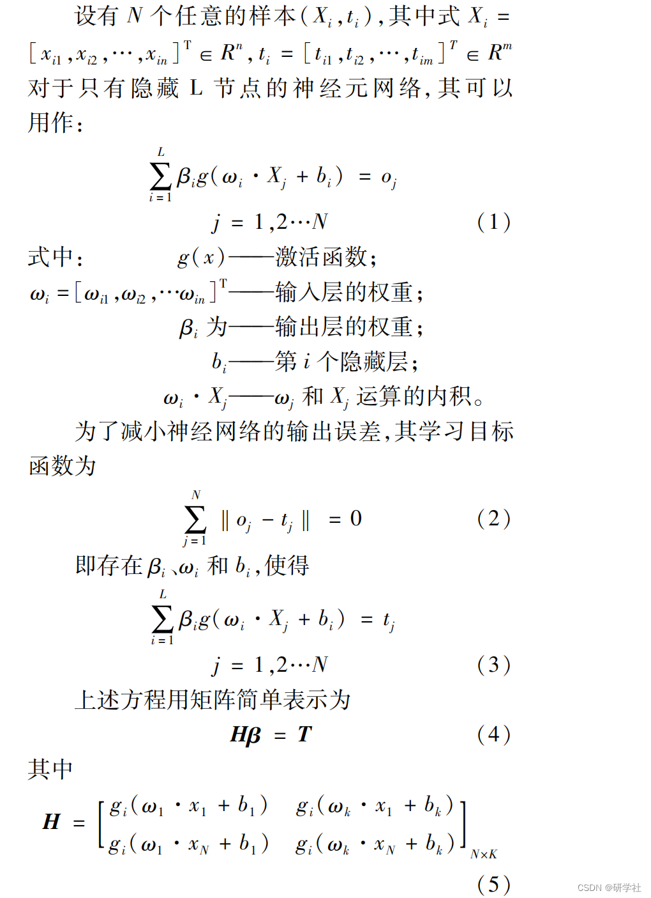
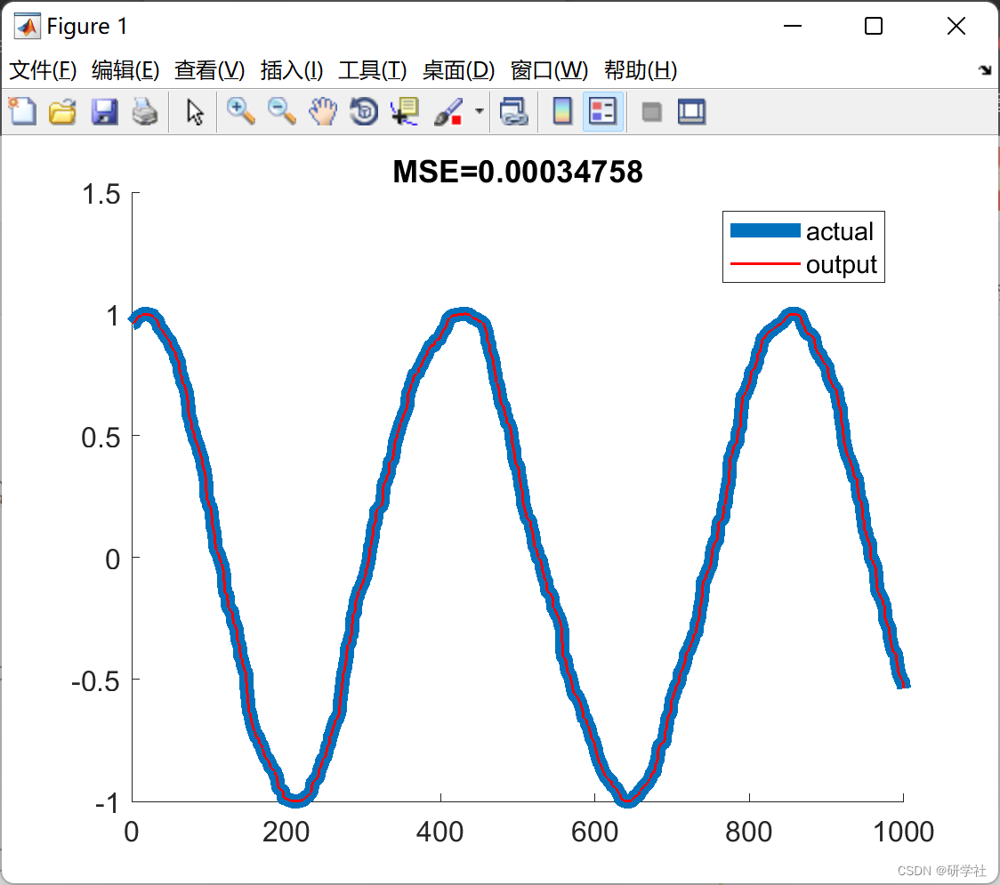

# Sinusoidal wave prediction based on ELM (Matlab code implementation)

💥💥💞💞 Welcome to this blog❤️❤️💥💥
🏆 Bloggers' Advantages: 🌞🌞🌞 The content of the blog strives for rigorous thinking and clear logic, making it convenient for readers.
⛳️ Mantra: A journey of a thousand miles is begun with a single step. Table of Contents💥1 Overview📚2 Run Results🎉3 References🌈4 MATLAB Code Implementation
💥1 Overview Extreme Learning Machine (ELM) Neural Network Model Compared to Other Methods, the ELM only needs to set the number of hidden layer neurons, and by solving the equation β, a unique optimal solution can be obtained. The ELM neural network model is shown in Figure 1.
​Edit
​Edit
📚2 Run Results​Edit
Part of the code:
%%%%%%%%%%% Load training dataset  
train_data = TrainingData_File;  
T = train_data(:,1)';  
P = train_data(:,2:size(train_data,2))';  
clear train_data;                 % Release raw training data array  
%%%%%%%%%%% Load testing dataset  
test_data = TestingData_File;  
TV.T = test_data(:,1)';  
TV.P = test_data(:,2:size(test_data,2))';  
clear test_data;                  % Release raw testing data array  
NumberofTrainingData = size(P,2);
NumberofTestingData=size(TV.P,2);  
NumberofInputNeurons=size(P,1);  
if Elm_Type~=REGRESSION  
%%%%%%%%%%%% Preprocessing the data of classification  
sorted_target=sort(cat(2,T,TV.T),2);  
label=zeros(1,1);               % Find and save in 'label' class label from training and testing data sets  
label(1,1)=sorted_target(1,1);  
j=1;  
for i = 2:(NumberofTrainingData+NumberofTestingData)  
if sorted_target(1,i) ~= label(1,j)  
j=j+1;  
label(1,j) = sorted_target(1,i);  
end  
end  
number_class=j;  
NumberofOutputNeurons=number_class;  
%%%%%%%%%% Processing the targets of training  
temp_T=zeros(NumberofOutputNeurons, NumberofTrainingData);  
for i = 1:NumberofTrainingData  
for j = 1:number_class  
if label(1,j) == T(1,i)  
break;  
end  
end  
temp_T(j,i)=1;  
end  
T=temp_T*2-1;  
%%%%%%%%%% Processing the targets of testing  
temp_TV_T=zeros(NumberofOutputNeurons, NumberofTestingData);  
for i = 1:NumberofTestingData  
for j = 1:number_class  
if label(1,j) == TV.T(1,i)  
break;  
end  
end  
temp_TV_T(j,i)=1;  
end  
TV.T=temp_TV_T*2-1;  
end                        % end if of Elm_Type  
%%%%%%%%%%% Calculate weights & biases  
start_time_train=cputime;  
%%%%%%%%%%% Random generate input weights InputWeight (w_i) and biases BiasofHiddenNeurons (b_i) of hidden neurons  
InputWeight=rand(NumberofHiddenNeurons,NumberofInputNeurons)*2-1;  
BiasofHiddenNeurons=rand(NumberofHiddenNeurons,1);  
tempH=InputWeight*P;  
clear P;                      % Release input of training data  
ind=ones(1,NumberofTrainingData);  
BiasMatrix=BiasofHiddenNeurons(:,ind);       % Extend the bias matrix BiasofHiddenNeurons to match the demention of H  
tempH=tempH+BiasMatrix;  
🎉3 References
[2] Shang Liqun, Li Hongbo, Hou Yadong, Huang Chenhao, Zhang Jiantao. Feature Selection and Optimized Extreme Learning Machine for Short-term Electricity Load Forecasting [J]. Journal of Xi'an Jiaotong University, 2022, 56(4): 165-175
[3]Apdullah YAYIK (2022). Sine wave learning with Extreme Learning Machine (MWE)  
🌈4 Matlab code implementation

## Images

<!-- PAYMENT_BLOCK -->

## Get this dataset

- Payment link (Stripe): [Buy now](https://buy.stripe.com/3cs8yP7sY87d0vu9AB)
- Payment QR code: 

<!-- /PAYMENT_BLOCK -->
